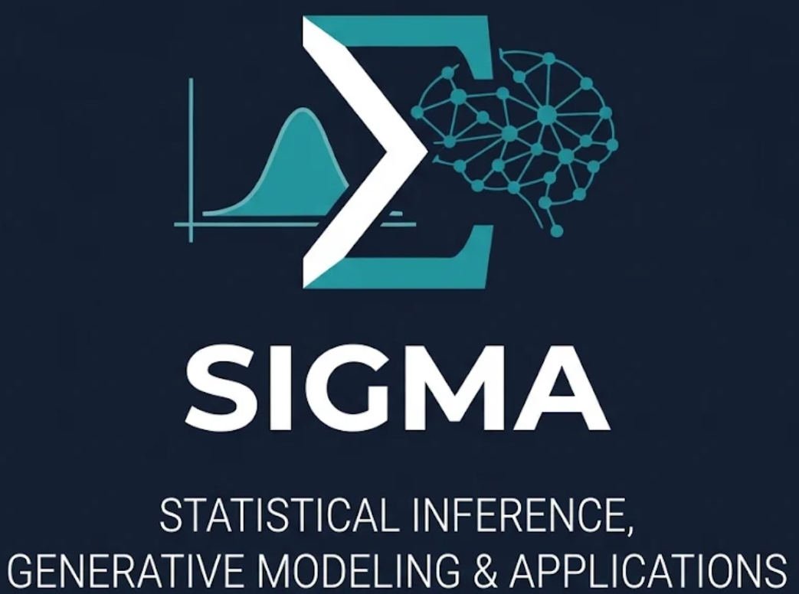
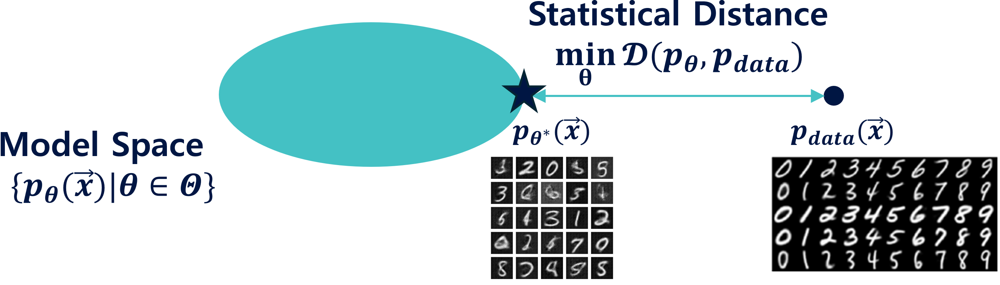
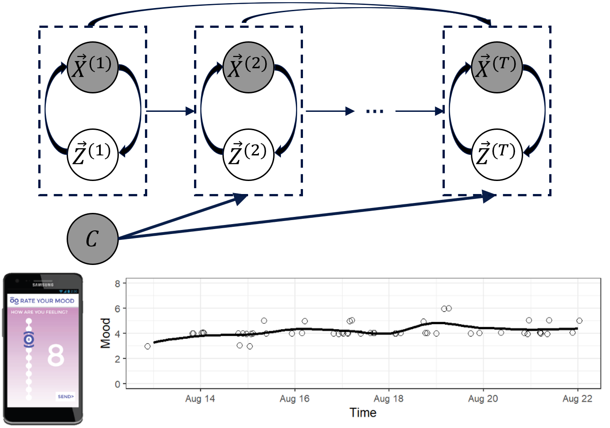
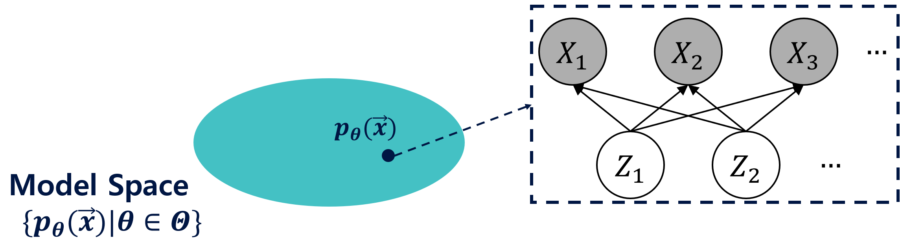
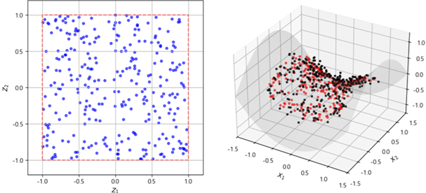
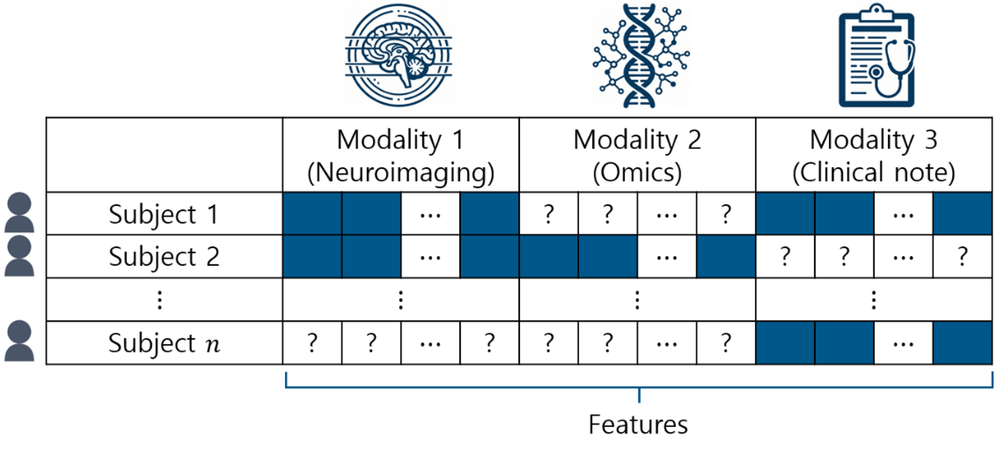
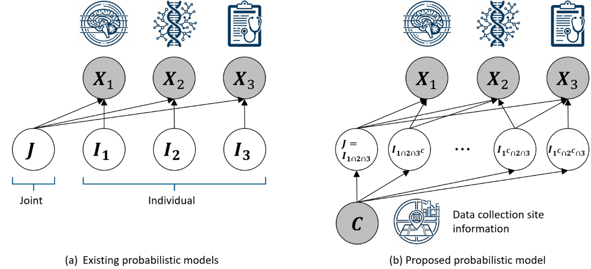

  

**Statistical Inference, Generative Modeling & Applications**  
통계추론 및 생성모형 연구실 | Department of Mathematical Sciences, UNIST

I am **Young-geun Kim**, a tenure-track Assistant Professor in the Department of Mathematical Sciences at UNIST. Before joining UNIST, I was the Hannan Endowed Visiting Assistant Professor in the Department of Statistics and Probability at Michigan State University (2024-2026) and a Postdoctoral Researcher in the Departments of Biostatistics and Psychiatry at Columbia University (2021-2024). I received my Ph.D. in Statistics from Seoul National University (2021).

📢 **Openings (Open Until Filled)**

- We welcome motivated **undergraduate research interns** and **M.S. / Ph.D. students** interested in statistical AI theory or biomedical/vision applications. Please contact Prof. Young-geun Kim (`younggeun91@unist.ac.kr`) with your CV and transcript.
- **UNIST-UTA Joint RA:** NIH-funded visiting research opportunity (up to 6 months) at the University of Texas at Arlington in neuroimaging AI. 👉 **[Program Details (PDF)](https://github.com/kyg0910/kyg0910.github.io/blob/master/_pages/UNIST-UTA%20joint%20research%20assistantship%20in%20neuroimaging.pdf)**

What is Statistical Generative Modeling?
======
High-dimensional data, across videos, languages, and biomedical records, can be governed by low-dimensional hidden factors (*representations*). **SIGMA Lab** combines **<u>S</u>tatistical <u>I</u>nference** and **<u>G</u>enerative <u>M</u>odeling with <u>A</u>pplications** via deep learning to understand complex data with mathematical guarantees.

> **Our Mission:** We build theoretically grounded Generative AI. We welcome students interested in either *math/statistics theory* or *biomedical & video data*!

<table style="width: 100%; table-layout: fixed; border-collapse: collapse; background: #ffffff; margin: 16px 0 24px 0;">
  <tr>
    <td width="50%" align="center" valign="middle" style="padding: 12px; border: 1px solid #cbd5e1;">
       
      <strong>(a) Statistical Inference:</strong> Learning <i>p</i>&theta;*(<b>x</b>) via statistical distance <i>D</i>(<i>p</i>&theta;, <i>p</i>data)
    </td>
    <td width="50%" align="center" valign="middle" style="padding: 12px; border: 1px solid #cbd5e1;">
       
      <strong>(b) Representation Learning:</strong> Extracting interpretable latent dynamics from mHealth data
    </td>
  </tr>
</table>

Research Fields
======

### 1. Theory: Probabilistic Modeling & Statistical Distances
**Keywords:** Deep Generative Models &middot; Statistical Distance &middot; Identifiability

We design latent variable models and optimal distance metrics with provable mathematical guarantees:

  <i>p</i>&theta;(<b>x</b>) = &int;<i>Z</i> <i>p</i>&theta;(<b>x</b> | <b>z</b>) <i>p</i>(<b>z</b>) <i>d</i><b>z</b>, &emsp;&emsp; &theta;* = arg min&theta; <i>D</i>(<i>p</i>&theta;, <i>p</i>data)

- **Statistical Distances:** Conditional Wasserstein generators capturing high-dimensional data geometry without mode collapse.
- **Identifiable Generative Models:** Mathematical conditions ensuring unique recovery of true hidden factors (<b>z</b>), even under missing data.

<table style="width: 100%; border-collapse: collapse; background: #ffffff; margin: 14px 0;">
  <tr>
    <td width="46%" align="center" valign="middle" style="padding: 12px; border: 1px solid #cbd5e1;">
       
      <strong>(a) Latent Variable Model:</strong> Latent (<i>Z</i>1, <i>Z</i>2) generates (<i>X</i>1, <i>X</i>2, <i>X</i>3)
    </td>
    <td width="8%" align="center" valign="middle" style="padding: 4px; border-top: 1px solid #cbd5e1; border-bottom: 1px solid #cbd5e1; font-size: 1.3em; color: #0e7490;">
      <strong>&rArr;</strong>
    </td>
    <td width="46%" align="center" valign="middle" style="padding: 12px; border: 1px solid #cbd5e1;">
       
      <strong>(b) Realization of (a):</strong> 2D (<i>Z</i>1, <i>Z</i>2) <em>(left)</em> &amp; 3D (<i>X</i>1, <i>X</i>2, <i>X</i>3) <em>(right)</em>
    </td>
  </tr>
</table>

**Key Related Research**
- **Kim, Y.-G.**, Lee, K., and Paik, M.C. (2023). Conditional Wasserstein generator. *IEEE Transactions on Pattern Analysis and Machine Intelligence (TPAMI)*. [[Paper]](https://ieeexplore.ieee.org/abstract/document/9944913) [[Code]](https://github.com/kyg0910/Conditional-Wasserstein-Generator)
- **Kim, Y.-G.**, Liu, Y., and Wei, X. (2023). Covariate-informed representation learning to prevent posterior collapse of iVAE. *AISTATS*. [[Paper]](https://proceedings.mlr.press/v206/kim23c/kim23c.pdf) [[Code]](https://github.com/kyg0910/CI-iVAE)
- **Kim, Y.-G.**, Kwon, Y., Chang, H., and Paik, M.C. (2020). Lipschitz continuous autoencoders in application to anomaly detection. *AISTATS*. [[Paper]](http://proceedings.mlr.press/v108/kim20c.html) [[Code]](https://github.com/kyg0910/Lipschitz-Continuous-Autoencoders-in-Application-to-Anomaly-Detection)

### 2. Convergence: Medical Neuroimaging & Video AI
**Keywords:** Multi-modal Data &middot; Neuroimaging &middot; Video &middot; Healthcare

Generative models deepen our understanding of data mechanisms, e.g., by disentangling shared (<b>j</b>) and modality-specific (<b>i</b><i>m</i>) factors given covariates <b>c</b>:

  <i>p</i>&theta;(<b>x</b>1:<i>M</i> | <b>c</b>) = &int;<i>J</i> &times; <i>I</i>1 &times; &#8943; &times; <i>I</i><i>M</i> <big>(</big>&prod;<i>m</i>=1<i>M</i> <i>p</i>&theta;<i>m</i>(<b>x</b><i>m</i> | <b>j</b>, <b>i</b><i>m</i>)<big>)</big> <i>p</i>&theta;(<b>j</b>, <b>i</b>1:<i>M</i> | <b>c</b>) <i>d</i><b>j</b> <i>d</i><b>i</b>1:<i>M</i>

- **Brain Imaging (MRI):** Discovering autism and OCD biomarkers from incomplete multi-site cohorts (ABCD, ENIGMA) under block-missingness.
- **Video & Image Synthesis:** Predicting future frames and multi-view images via conditional Wasserstein and geodesic models.
- **Digital Health & RL:** Modeling mobile mood dynamics (EMA) and optimizing personalized clinical treatments via reinforcement learning.

<table style="width: 100%; border-collapse: collapse; background: #ffffff; margin: 14px 0;">
  <tr>
    <td width="46%" align="center" valign="middle" style="padding: 12px; border: 1px solid #cbd5e1;">
       
      <strong>Incomplete Multi-modal Data:</strong> Site-specific block-missingness
    </td>
    <td width="8%" align="center" valign="middle" style="padding: 4px; border-top: 1px solid #cbd5e1; border-bottom: 1px solid #cbd5e1; font-size: 1.3em; color: #0e7490;">
      <strong>&rArr;</strong>
    </td>
    <td width="46%" align="center" valign="middle" style="padding: 12px; border: 1px solid #cbd5e1;">
       
      <strong>Covariate-Informed Disentanglement:</strong> Separating shared &amp; subset-specific factors
    </td>
  </tr>
</table>

**Key Related Research**
- **Kim, Y.-G.** et al. (2024). Explaining deep learning-based representations of resting state functional connectivity data: focusing on interpreting nonlinear patterns in autism spectrum disorder. *Frontiers in Psychiatry*.
- Kim, S., **Kim, Y.-G.**, and Wang, Y. (2024). Temporal generative models for learning heterogeneous group dynamics of ecological momentary data. *Biometrics*. [[Paper]](https://academic.oup.com/biometrics/article/80/4/ujae115/7821109)
- **Kim, Y.-G.**, Hu, M.-C., Nunes, E.V., Luo, S.X., and Liu, Y. (2025). Optimizing contingency management with reinforcement learning. *IEEE ICHI* (Long Presentation).

Related Courses & Open Materials
======
- **MTH345: Deep Generative Models: A Statistical Perspective** (UNIST) [[Course Material & Pilot Lecture Videos]](https://github.com/kyg0910/DeepGenerativeModel-A-Statistical-Perspective)
- **MTH344: Mathematical Statistics** (UNIST) [[Course Material]](https://github.com/kyg0910/MTH344-Mathematical-Statistics)
- **STT997: Advanced Topics in Statistics** (MSU) [[Course Material]](https://github.com/kyg0910/-STT997-Deep-Generative-Model/tree/main)
- **Related UNIST Courses:** MTH342 (Probability), AI518 (Deep Generative Models)

Recent News
======
- **[Fall 2026]** Presenting invited talks on *Multi-Modal Representation Learning with Partially Pairwise Observations* at **CFE-CMStatistics 2026** (Berlin, Germany) and the **KMS Fall Conference** (Gwangju).
- **[09-01-2026]** Launched a newly developed undergraduate course at UNIST: *MTH345: Deep Generative Models: A Statistical Perspective*.
- **[Summer 2026]** Presented invited talks at **ICSA-China 2026** (Shenzhen, China) and the **KSS Summer Conference** (Gyeongju).
- **[03-12-2026]** Our proposal for new course development (*Deep Generative Models: A Statistical Perspective*) has been accepted by UNIST (KRW 20,000,000, 04/2026-07/2026, Role: **Principal Developer**).
- **[02-01-2026]** Joined the Department of Mathematical Sciences at **UNIST** as a tenure-track Assistant Professor.
- **[08-06-2025]** Our grant proposal (*Statistical Understanding of Adversarial Training in Neural Networks*, USD 180,000, 08/2025-07/2028) has been funded by the **U.S. National Science Foundation (NSF DMS)** (Role: **Co-PI & Int'l Consultant**; PI: Dr. Yue Xing, MSU).
- **[03-27-2025]** Paper accepted at **MIDL 2025**: *A Novel GNN Framework Integrating Neuroimaging and Behavioral Information to Understand Adolescent Psychiatric Disorders*.
- **[03-12-2025]** Paper accepted at **IEEE ICHI 2025** (selected as a long presentation): *Optimizing Contingency Management with Reinforcement Learning*.
